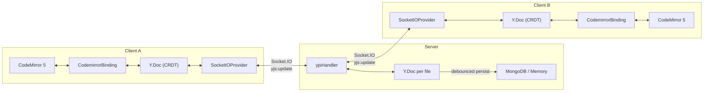

# CRDT Collaborative Editing — Implementation Summary

## Problem Solved

The old approach used `setValue()` on every remote `CODE_CHANGE` event, which:
- **Destroyed cursor position** — your cursor jumped to the top on every remote keystroke
- **Lost concurrent edits** — last-write-wins, no conflict resolution
- **Couldn't answer the interview question** — *"How do you handle two users typing at the same time?"*

## Architecture



## Files Changed / Created

### New Files

| File | Purpose |
|------|---------|
| [`yjsHandler.js`](file:///c:/Users/jadon/OneDrive/Desktop/code_editor_project/real_time_code_editor/server/socket/yjsHandler.js) | Server-side Yjs doc management, sync protocol over Socket.IO |
| [`SocketIOProvider.js`](file:///c:/Users/jadon/OneDrive/Desktop/code_editor_project/real_time_code_editor/client/src/crdt/SocketIOProvider.js) | Custom Yjs provider using existing Socket.IO connection |
| [`CodemirrorBinding.js`](file:///c:/Users/jadon/OneDrive/Desktop/code_editor_project/real_time_code_editor/client/src/crdt/CodemirrorBinding.js) | CodeMirror 5 ↔ Yjs binding using surgical `replaceRange()` |

### Modified Files

| File | What Changed |
|------|-------------|
| [`Editor.jsx`](file:///c:/Users/jadon/OneDrive/Desktop/code_editor_project/real_time_code_editor/client/src/components/Editor.jsx) | Replaced raw `setValue()` with CRDT binding. Each file gets its own `Y.Doc` + provider + binding lifecycle |
| [`socketHandlers.js`](file:///c:/Users/jadon/OneDrive/Desktop/code_editor_project/real_time_code_editor/server/socket/socketHandlers.js) | Registers Yjs handlers, syncs legacy CODE_CHANGE with CRDT docs, cleans up on file delete |

## How It Works

### Sync Protocol (over Socket.IO)

1. **Client opens a file** → emits `yjs:sync-request`
2. **Server** creates/retrieves Y.Doc, pre-populates with DB content → sends `yjs:sync-step1` (full state)
3. **Client** applies server state, sends back its own state via `yjs:sync-step2`
4. **Incremental edits** flow as `yjs:update` — small binary deltas, not full file content

### Conflict Resolution (CRDT)

- **No more last-write-wins.** Yjs uses a CRDT (Conflict-free Replicated Data Type)
- Two users typing at position 10 simultaneously → both insertions are preserved, correctly ordered
- The Yjs merge algorithm guarantees **eventual consistency** across all clients without a central authority

### Cursor Preservation

- Old: `setValue(code)` — replaces entire buffer, cursor resets
- New: `replaceRange(text, from, to)` — surgical insert/delete at exact positions, cursor stays put

### DB Persistence

- CRDT updates are debounced (2s) before writing to MongoDB
- The legacy `CODE_CHANGE` path still works for AI apply-fix and is synced into the CRDT doc

## Dependencies Added

```
# Client
yjs, y-codemirror, y-codemirror.next, lib0

# Server
yjs, lib0
```

## Interview Answer

> *"How do you handle two users typing at the same time?"*

Each client maintains a local Yjs Y.Doc (CRDT) bound to CodeMirror via a custom binding. Edits are captured as insert/delete operations on the Y.Text shared type. These operations are encoded as compact binary deltas and synced through the server via Socket.IO. The server maintains an authoritative Y.Doc per file for late-joining clients. Yjs's CRDT guarantees that all clients converge to the same state regardless of operation ordering — no central coordinator or lock required. The binding uses surgical `replaceRange()` calls instead of `setValue()`, so remote edits never disturb the local user's cursor position.
